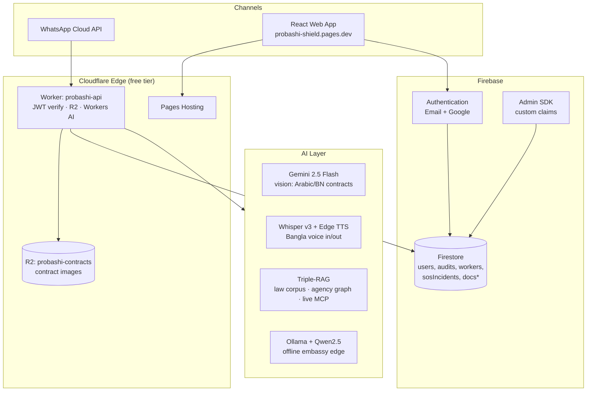
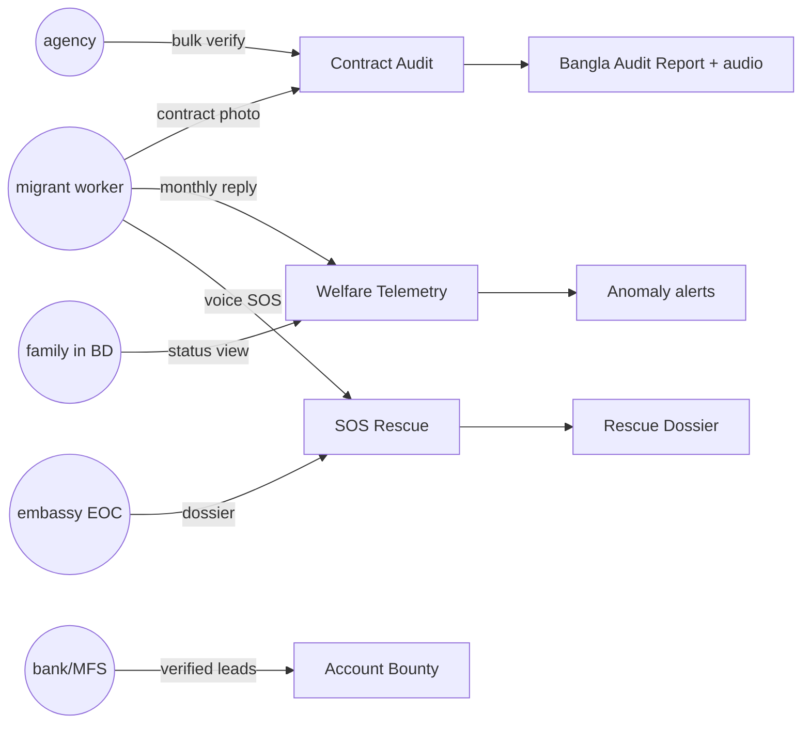
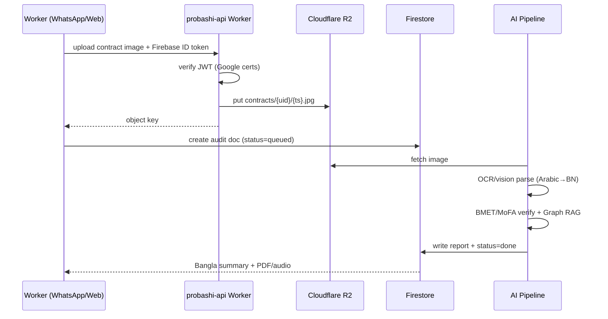

# ProbashiShield AI — প্রবাসীশিল্ড এআই

**The 24/7 Autonomous AI Guardian for 1.2 Crore Migrant Workers.**
WhatsApp-native verification, welfare telemetry and crisis-response platform for Bangladeshi migrant workers. Team **Clyber** — International AI Builders Congress 2026, CivicSphere & FinSphere AI, Idea to Unicorn track.

Live: https://probashi-shield.pages.dev · Docs: https://probashi-shield.pages.dev/docs · Repo: https://github.com/nayeemlabs/probashi-shield-ai

---

## System Architecture



## Use Case Diagram



## Data Flow



## Deployment Map

| Layer | Service | Cost |
|---|---|---|
| Hosting | Cloudflare Pages `probashi-shield` | Free |
| API/Storage | Worker `probashi-api` + R2 `probashi-contracts` | Free (10GB) |
| Auth/DB | Firebase Spark (Auth, Firestore) | Free |
| AI | Workers AI + Gemini API | Free tier |
| Repo | github.com/nayeemlabs/probashi-shield-ai | Public |

## Repo Layout

```
web/                 React 19 + TS + Vite + Tailwind v4 frontend
workers/api/         Cloudflare Worker (upload, file serve, admin stats, AI binding)
firestore.rules      RBAC: owner / family / embassy / admin claims
firebase.json        Firestore rules deploy config
deploy.ps1           One-command local deploy (build + Pages + rules)
tools/               Asset renderer, deck generator, admin-claim, docs seeder
assets/              Brand SVG/PNG, OG images, fonts (local only)
docs/                Internal docs (gitignored): PRD, deck PPTX, video script
tools/make-deck.mjs  Pitch deck generator (pptxgenjs)
```

## Key Routes

`/` landing · `/login` auth · `/audit` contract upload · `/family` `/eoc` `/agency` dashboards · `/settings` profile+avatar · `/admin` super-admin portal · `/admin/docs` docs editor · `/docs` live pitch deck + tech docs (schedulable)

## Security Model

Firebase Auth JWT verified in Worker via Google certs; Firestore rules enforce owner/role claims; R2 objects private, served only through Worker with ownership check; admin via `admin` custom claim; secrets in `.env` (gitignored) and Worker bindings, never in repo.
